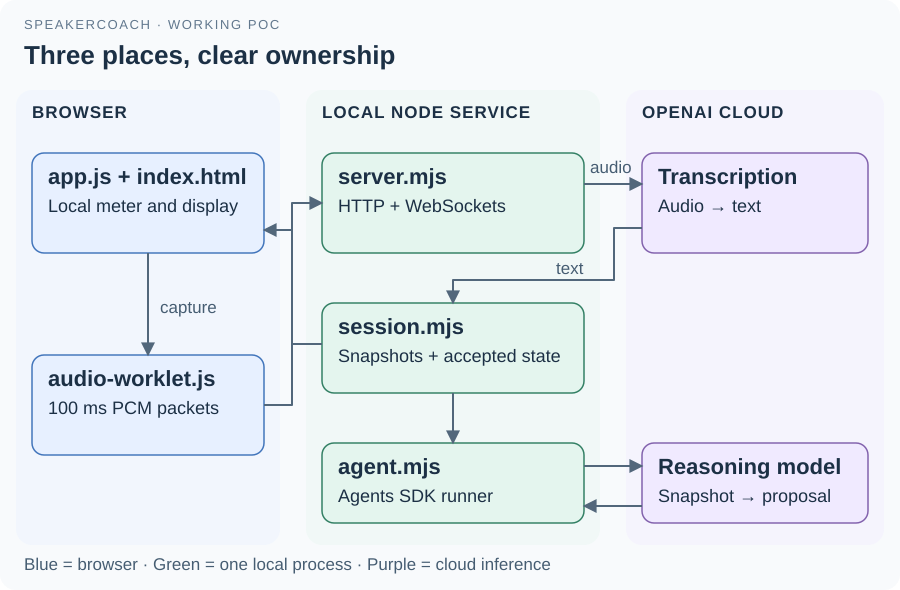

# 02 · Architecture and component ownership

The implementation has a browser, one local service and two cloud operations.
The modules inside the service share a process; they are not separate deployed services.
Session state lives in memory and is discarded when its connection ends.

| Component | Owns | Main collaborators |
| --- | --- | --- |
| [index.html](../../index.html) | Page structure, colors' display surface and response overlay | [app.js](../../app.js) |
| [app.js](../../app.js) | Microphone lifecycle, local timer, packet headers and rendered updates | Web Audio, worklet, local WebSocket |
| [audio-worklet.js](../audio-worklet.js) | Channel mixing, resampling and PCM packet production | Browser audio graph and message port |
| [server.mjs](../server.mjs) | HTTP routes, socket lifecycle, transcription transport and audio-turn commits | Browser, OpenAI transcription, session |
| [session.mjs](../session.mjs) | Ordered observations, reasoning schedule and accepted interview state | Agent function and browser event sink |
| [agent.mjs](../agent.mjs) | Agent instructions, typed output schema and model invocation | Agents SDK and OpenAI model |
| [start.sh](../start.sh) | Node discovery and server startup with local configuration | Node runtime and server entry point |

## The two cloud operations

The transcription WebSocket receives PCM audio and returns text deltas and completed segments.
The agent receives a bounded JSON snapshot of available text and accepted state, and returns a structured proposal.
Transcription does not wait for reasoning. The session permits one reasoning call at a time and combines new observations into the next snapshot.

## Boundaries that matter

The service binds to 127.0.0.1 and checks the browser's origin. Only four explicit public assets and the health route are served.
The API key is loaded by Node from the ignored local environment file. It is never sent to the browser.
Audio and selected transcript text do leave the machine for OpenAI; the current application has no database or durable conversation history.
The agent has no application tools, shell or file access. This configuration is distinct from the stronger replay isolation envisioned in the architecture documents.

The code controls capture and publication. The model supplies an interpretation whose semantic accuracy still needs evaluation.

[Guide](README.md) · [Browser detail](03-browser-and-audio.md) · [Server detail](04-server-and-protocol.md)
