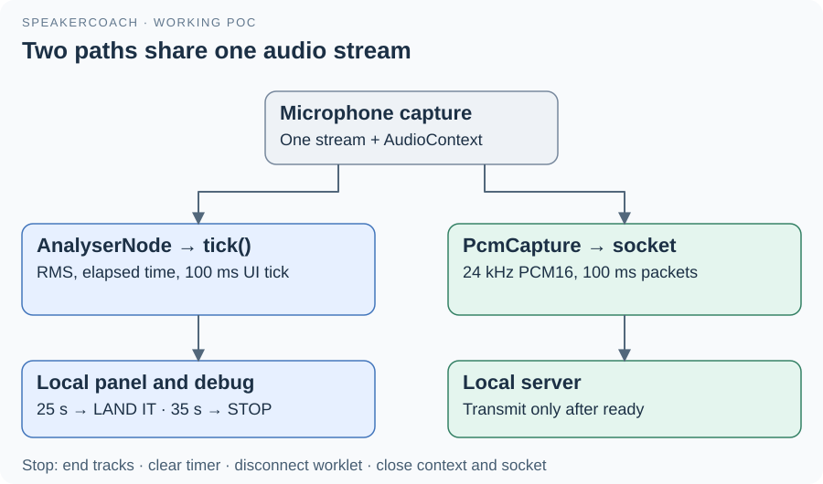

# 03 · Browser capture and local feedback

[app.js](../../app.js) opens one microphone stream, then creates two consumers in the same Web Audio graph.
The analyser drives immediate visual feedback. The worklet prepares audio for the server without using the UI timer.

## Local feedback path

`startListening()` acquires the stream, resumes an AudioContext and schedules `tick()` every 100 ms.
`tick()` computes RMS, a measure of average signal amplitude, from an AnalyserNode buffer and updates the speaking turn.

| Setting in app.js | Current behavior |
| --- | --- |
| RMS greater than 0.02 | Updates the last-voice time and starts a turn if necessary |
| 300 ms speaking hold | Brief gaps do not immediately clear the speaking indicator |
| More than 2500 ms silence | Ends the detected turn and resets elapsed duration |
| More than 25 / 35 seconds | Changes the panel to gold LAND IT / red STOP |
| Otherwise | Shows green GOOD |

These colors describe duration, not the agent's assessment. The manual color buttons still work, although the next audio tick can replace their selection.

## Server audio path

`connectServer()` loads [PcmCapture](../audio-worklet.js), whose `process(inputs)` averages channels and resamples to mono 24 kHz.
Each transferred worklet buffer contains 2400 signed 16-bit samples: 100 ms of audio.
The page adds sequence and starting-sample fields, then sends the packet only after the server reports `ready`.
The worklet's output graph is muted to avoid microphone playback through the speakers.
Audio spoken during connection setup is not transmitted; wait for “listening on server” before starting the demonstration.

## Display and cleanup

Incoming transcript and answer events update `remote`; `renderServer()` assigns text with `textContent`.
Only increasing answer revisions are displayed. A render acknowledgement is sent from a `requestAnimationFrame` callback.
`stopListening()` clears the timer, ends tracks, disconnects capture, closes the AudioContext and closes the socket.
The `current` resource object acts as a generation token: an old permission request or callback cannot update a newer session.
Connection failures preserve local feedback and the last reply, with visible status; restart explicitly to reconnect.

[Guide](README.md) · [Browser companion](../../app.md) · [Worklet companion](../audio-worklet.md)
