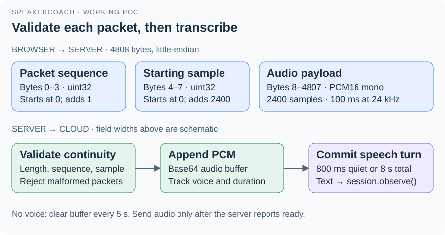

# 04 · Server routes and audio protocol

[createPocServer()](../server.mjs) builds the HTTP server and the browser WebSocket endpoint.
Its injected `reason`, `connect` and `audit` collaborators let tests exercise the transport without contacting OpenAI.

| Interface | Contract |
| --- | --- |
| GET / and /index.html | Serve the existing page |
| GET /app.js and /poc/audio-worklet.js | Serve only these browser scripts |
| GET /health | Return process availability, credential presence and active-session count |
| WebSocket /session | Accept one active browser session; require matching local Host and Origin |
| Other paths / non-GET HTTP | Return 404 / 405 after the Host check |

## Browser → server

A binary audio message is exactly 4808 bytes. Bytes 0–3 contain the zero-based packet sequence; bytes 4–7 contain its starting sample index; the remaining 4800 bytes contain 2400 PCM16 samples.
Numbers use little-endian encoding. Each accepted packet advances the sequence by one and the sample index by 2400.
`InterviewSession.audio()` rejects wrong sizes, missing sequence numbers and discontinuous sample positions.
Text messages are JSON controls: `{"type":"stop"}` closes the session; `{"type":"rendered","revision":2}` records a browser acknowledgement, optionally with the `liveId` and `liveVersion` it displayed.
Question controls (`question.reset`, `question.confirm`) are described in [question controls](04.1-question-controls.md).

## Server → OpenAI transcription

The server opens a dedicated transcription WebSocket and configures 24 kHz PCM with `session.update`.
After `session.updated`, it tells the page to begin sending. PCM is base64-encoded for `input_audio_buffer.append`.
The server's own RMS threshold is 0.012. Once speech is observed, it commits after 800 ms silence or eight seconds of buffered audio.
Pure-silence buffers clear every five seconds. These transcription boundaries are independent of the browser's 2.5-second local turn reset.
Committed item IDs preserve segment order; delta and completed events feed `session.observe()`.

## Server → browser and failure handling

Events carry `type`, `sessionId` and `serverAt`. Types include `ready`, `status`, `audio`, `transcript`, `agent`, `answer` and `question.result`.
Every ten audio packets, the browser receives a count and source duration. An answer adds revision, phase, reply, audio cutoff, `focus`, `focusVersion`, `exchangeId` and `live`.
Audio send buffers are capped at 96,000 bytes; the downstream browser event buffer is capped at 65,536 bytes. These are byte limits, not measured latency guarantees.
Transcription readiness has a 20-second timeout; a session has a 30-minute POC limit. Invalid input, lost transcription or excessive buffering closes the connection with status.
An agent-call failure is handled separately by the session, preserving the last accepted result while transcription can continue.

[Guide](README.md) · [Server companion](../server.md) · [Next: agent and state](05-agent-and-state.md)
