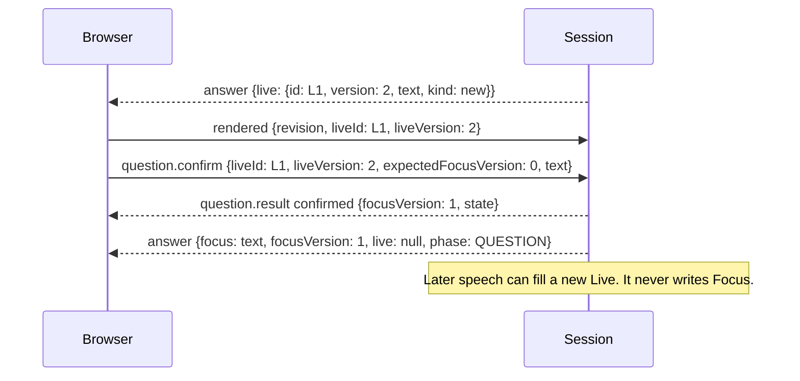

# 04.1 · Question controls

Pablo uses these controls to make the Live question his Focus question, or to clear Live when it picked up the wrong words. The browser sends them on the same `/session` WebSocket as audio; audio intake does not wait for them. The [UC-04 low-level design](../../docs/asdg/08-low-level-design/03.3-uc-04-protocol.md) defines this protocol.



| Control | Payload |
| --- | --- |
| `question.reset` | `{type, sessionId, requestId}`: clears Live and moves its cutoff; Focus is untouched |
| `question.confirm` | `{type, sessionId, requestId, liveId, liveVersion, expectedFocusVersion, text}`; IDs are 1–100 characters, versions are safe non-negative integers, text is 1–600 characters |
| `question.result` | `{type, sessionId, serverAt, requestId, status, state}`; `confirmed` adds `liveId`, `liveVersion` and `focusVersion` |

Status is `reset`, `confirmed`, `stale` (Live or Focus changed since it was displayed, or the Live id was retired by an earlier Confirm or Reset), `invalid` (malformed, wrong session, a Live id never issued, altered text, or a reused `requestId` with a different payload), `unavailable` (session stopped, or Live text equals Focus) or `limit` (more than 256 distinct requests in this session).
The result always comes before the `answer` broadcast that a change causes. `state` is the session state when the result was produced, so a retried result can be older than the page's display.

## Examples

```json
{"type":"question.confirm","sessionId":"5f0c…","requestId":"r2","liveId":"9b2e…","liveVersion":2,"expectedFocusVersion":0,"text":"Tell me about your last two jobs."}
{"type":"question.result","sessionId":"5f0c…","serverAt":1793818004200,"requestId":"r2","status":"confirmed","liveId":"9b2e…","liveVersion":2,"focusVersion":1,"state":{"revision":6,"phase":"QUESTION","focus":"Tell me about your last two jobs.","focusVersion":1,"exchangeId":1,"live":null}}
{"type":"question.reset","sessionId":"5f0c…","requestId":"r3"}
{"type":"question.result","sessionId":"5f0c…","serverAt":1793818009000,"requestId":"r3","status":"reset","state":{"revision":8,"focus":"Tell me about your last two jobs.","live":null}}
```

`state` is abbreviated above. A stale confirmation returns `{"requestId":"r4","status":"stale","state":{…}}` with the newer Live for renewed review. Sending `r2` again unchanged returns the original `confirmed` result without committing twice.
A `rendered` acknowledgement that names a Live id records display only. Consent exists only as a `confirmed` result.

[Server and protocol](04-server-and-protocol.md) · [Session companion](../session.md) · [Guide](README.md)
