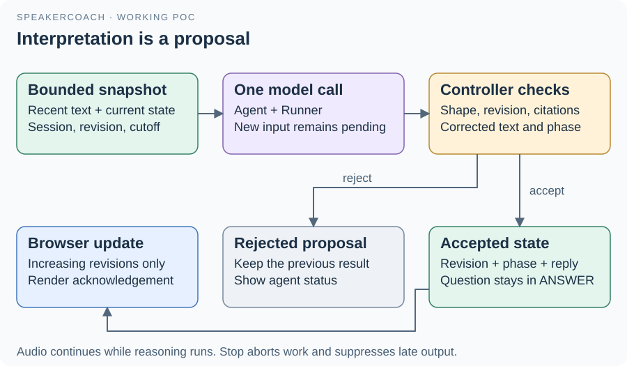

# 05 · Agent reasoning and accepted state

[agent.mjs](../agent.mjs) supplies the model-driven interpretation.
[InterviewSession](../session.mjs) owns the state that the page is allowed to display.
The model never directly writes the browser or mutates that state.

## Available context and scheduling

`committed()` and `observe()` reconcile segments by item ID. Deltas append; final text replaces the partial text; subsequent events for a finalized item are ignored.
The session retains at most 32 ordered items, with each observation capped at 4000 characters.
`snapshot()` includes the last six ordered items that have text, the current state, session identity, base revision and audio cutoff.
`schedule()` allows one active reasoning request. New input sets a pending flag, so the next call receives the latest available snapshot.
Starts are spaced by at least 2500 ms; each call has a 30-second timeout. Audio intake proceeds while the model is busy.

## Model proposal

`createReasoner()` constructs an Agents SDK Agent and Runner. Current defaults are `gpt-6-astra`, low reasoning effort, at most 800 output tokens and one model turn.
SDK tracing is disabled and response storage is requested off. Those settings do not remove cloud processing.
The output schema requires `reply`, `phase`, nullable `question` and an array of `evidenceIds`.
The phase proposal is GREETINGS, QUESTION, ANSWER or CLOSING; the application initializes state as STARTED.
A connection-only readiness reply has no audio evidence and leaves the phase STARTED.

## Controller acceptance

`accept(proposal, snapshot)` checks active session identity, base revision, output schema, text bounds and citations to available observations.
It rejects evidence corrected to different final text since the snapshot, a return to GREETINGS after later phases, and ANSWER without an established question.
Hard text limits are 500 characters for the reply and 600 for the question; the agent prompt requests shorter output.
A new question is stored only for a QUESTION proposal with nonblank question text and at least one cited final observation.
Otherwise the existing question stays in place, including during ANSWER. Accepted state advances its revision and emits an `answer` event.
This is a small deterministic controller, not the full intended interview state machine. Structural checks do not prove that the model understood the speaker correctly.

`stop()` aborts reasoning and clears observations. Its active-session check suppresses late output after closure.
See the [agent companion](../agent.md) and [session companion](../session.md) for callable interfaces.

[Guide](README.md) · [Next: code navigation](06-code-navigation.md)
