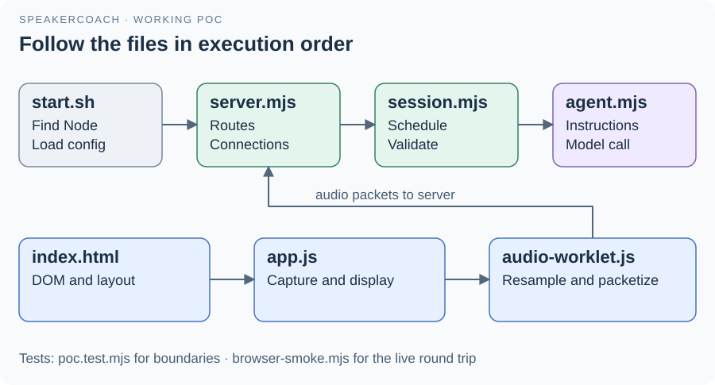

# 06 · How to navigate the code

Read the code along a real interaction: start the service, start listening, follow one packet, then follow the returned answer.
The same-name Markdown companions provide interface notes without requiring you to read every implementation line.

| # | Source → companion | What to inspect first |
| --- | --- | --- |
| 1 | [start.sh](../start.sh) → [start.md](../start.md) | Node lookup and environment-file loading |
| 2 | [server.mjs](../server.mjs) → [server.md](../server.md) | Executable entry point, `createPocServer()`, routes and connection handler |
| 3 | [index.html](../../index.html) → [index.md](../../index.md) | `panel`, `debug`, `server` and `listen` DOM elements |
| 4 | [app.js](../../app.js) → [app.md](../../app.md) | `startListening()`, `tick()`, `connectServer()`, `stopListening()` |
| 5 | [audio-worklet.js](../audio-worklet.js) → [audio-worklet.md](../audio-worklet.md) | `PcmCapture.process()` and its message port |
| 6 | [session.mjs](../session.mjs) → [session.md](../session.md) | `audio()`, `observe()`, `snapshot()`, `schedule()`, `run()`, `accept()` |
| 7 | [agent.mjs](../agent.mjs) → [agent.md](../agent.md) | Agent instructions, `proposalSchema` and `createReasoner()` |
| 8 | [poc.test.mjs](../poc.test.mjs) → [test guide](../poc.test.md) | Boundary fixtures and controller invariants |
| 9 | [browser-smoke.mjs](../browser-smoke.mjs) → [smoke guide](../browser-smoke.md) | Real browser/audio/cloud proof and Stop assertions |

## Where a change belongs

| Desired change | Start here; keep these collaborators aligned |
| --- | --- |
| Change local colors or timing | `STATES` and threshold constants in app.js; update app.md |
| Change layout or response text placement | index.html and `renderServer()`; preserve the DOM contract |
| Change audio encoding or packet duration | Worklet, app packet header, session validation and server timing together |
| Change model behavior | Agent instructions/schema and environment defaults; check controller validation and tests |
| Change question retention or stale-result rules | `InterviewSession.accept()` and the corresponding deterministic tests |
| Change transcription or connection recovery | server.mjs transport and cleanup; app.js connection status |
| Investigate a missing reply | Server status → transcript events → agent status → acceptance → browser revision |

[package.json](../package.json) declares dependencies and scripts; [pnpm-lock.yaml](../pnpm-lock.yaml) records installed versions. Generated `node_modules/` is not application source.
The original product intent lives under [docs/asdg](../../docs/asdg/README.md); embedded methodology rules live under [asdg](../../asdg/README.md).
[RESULTS.md](../RESULTS.md) and [evidence.json](../evidence.json) are historical execution records. Preserve them when documenting later runs.

[Guide](README.md) · [Next: run and verify](07-running-and-verification.md)
