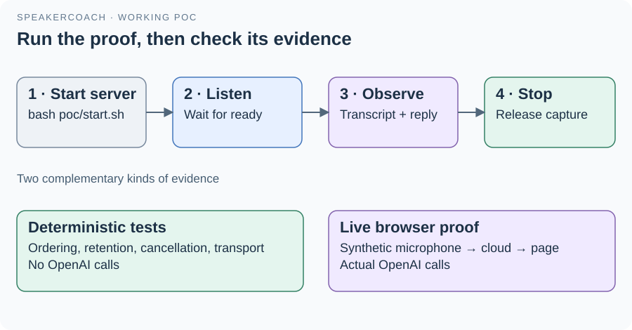

# 07 · Run, observe and verify

The POC runs as one local Node process. Open the page through that process so its worklet and WebSocket share the expected origin.
Node.js 22+ is required. The launcher can also find the installed Codex Node runtime when Node is absent from PATH.

## Start the demonstration

From the repository root, run `bash poc/start.sh`, then open [the page](http://127.0.0.1:3000).
For a fresh checkout, install dependencies inside `poc/` with `pnpm install --ignore-scripts` and configure an ignored `poc/.env.local`; use [.env.example](../.env.example) for variable names.
Press **Start Listening**, grant microphone access and wait for **listening on server** before speaking.
Watch local level and duration, then the server's received-audio count, transcript and input-dependent reply.
Press **Stop listening** to release capture; use Ctrl+C in the server terminal to stop the service. After a connection error, restart listening explicitly.

| Variable | Current default / purpose |
| --- | --- |
| OPENAI_API_KEY | Required server credential; never put it in browser code |
| OPENAI_MODEL | `gpt-6-astra` for reasoning |
| TRANSCRIPTION_MODEL | `gpt-live-transcribe` for live transcription |
| PORT | 3000; binding remains 127.0.0.1 |
| SPEAKERCOACH_NODE | Optional explicit Node executable for start.sh |

Only one browser session can listen at a time. A health response confirms the process and configuration presence, not a successful OpenAI request.

## Verify the right layer

`node --test poc/poc.test.mjs` runs eighteen deterministic cases, including a temporary localhost server; these tests do not call OpenAI.
`node poc/browser-protocol.mjs` checks the question panel in headless Chrome against a scripted session, also without OpenAI; see [its companion](../browser-protocol.md).
`node poc/live-capture.mjs` records a live session's messages, times and checkpoints for the UC-04 live check; see [its companion](../live-capture.md).
`node poc/browser-smoke.mjs /absolute/path/to/synthetic.wav` runs the live browser proof against an already-running service and makes OpenAI requests.
The smoke script needs Playwright and a browser; [its companion](../browser-smoke.md) explains `PLAYWRIGHT_MODULE`, `CHROME_PATH` and `POC_URL`.
Use a synthetic fixture for that check. It is not an isolated replay of the private interview benchmark.

## Existing evidence and limits

The [recorded run](../RESULTS.md) passed all eight tests and displayed an actual audio-dependent response in Chrome. Its timer checks used controlled inputs rather than waiting through a 36-second answer.
The accepted audio request took 1482 ms; its browser acknowledgement reached the server 22 ms later. Those are one-trial wall-clock measurements, not benchmark latency guarantees.
After that demonstration the user reported successful use on 26 October 2026. No instrumented physical-microphone measurement accompanied that report.
Transcript accuracy, speaker identity, interview effectiveness, isolated benchmark replay and full Sprint 0 acceptance remain separate evaluations.
This guide was checked against source and rendered for readability; documentation work did not rerun the cloud experiment or close the sprint.

[Guide](README.md) · [Code navigation](06-code-navigation.md)
