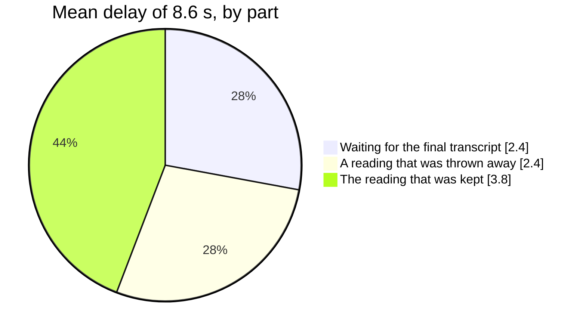

# Response time: the measured times

This page holds the measurements behind the [response-time analysis](08-response-time.md): seven questions asked by Pablo in three real sessions on 21 November 2026, with the folder package of 3 files and 18,843 characters, the reader model `gpt-6-astra` at reasoning effort `low` and the transcription model `gpt-live-transcribe`.

*Mean of the seven questions, in seconds. The thrown-away reading is 3.3 s on the five questions that had one.*

## The seven questions

| Run | Question | End of speech to transcript | Thrown-away reading | Kept reading | Total |
| --- | --- | --- | --- | --- | --- |
| A, 05:49 UTC | 1 | 2.2 s | none | 4.3 s | 6.4 s |
| A | 2 | 2.2 s | 3.4 s | 4.4 s | 10.0 s |
| B, 05:53 UTC | 1 | 2.3 s | 3.0 s | 3.0 s | 8.3 s |
| C, 06:29 UTC | 1 | 2.6 s | 4.1 s | 3.6 s | 10.3 s |
| C | 2 | 2.5 s | 2.3 s | 2.7 s | 7.6 s |
| C | 3 | 2.5 s | none | 4.8 s | 7.3 s |
| C | 4 | 2.6 s | 3.9 s | 3.8 s | 10.3 s |
| **Mean** | | **2.4 s** | **2.4 s** | **3.8 s** | **8.6 s** |

The first column includes the service's own 0.8-second pause rule, so transcription itself takes about 1.6 seconds. After the answer is accepted the page shows it within 2 to 7 milliseconds; the page and the log add no visible delay.

## The 23 model calls

| Kind of call | Calls | Duration | Share of model time |
| --- | --- | --- | --- |
| Kept, with a new Question and answer | 7 | 2.7 to 4.8 s, mean 3.8 | 35% |
| Kept, no new question (Pablo was answering) | 4 | 2.2 to 2.7 s, mean 2.6 | 14% |
| Rejected because the words changed | 12 | 2.5 to 4.5 s, mean 3.2 | 51% |

- **Even an empty reading takes 2.2 to 2.7 seconds.** Writing the three bullets adds at most about 2 seconds on top. The fixed part of a call, with the whole package in it, is the larger cost.
- **No first-question penalty shows.** In run A the first question was the fastest; in run C the first and the fourth were equally slow.
- **Sixteen of 23 calls showed nothing new**, and each carried the package, an estimated 4,700 tokens (characters divided by four; not measured).

## How it was measured, and its limits

- **Sources.** The end of speech is `pause.startMs` in the meeting log; the transcript and the Question are the log's `transcript` and `focus_changed` times; call durations are the `agent_started` and `agent_finished` lines of the service's terminal output, which is not saved to a file.
- **Precision.** The end of speech is counted in audio packets of 0.1 s and compared with the session clock, so each total is good to about 0.3 s.
- **Small sample.** Seven questions, one speaker, one evening, one network. The ranges are real; the means may move.
- **Not measured.** Tokens, cost, whether OpenAI cached any part of a prompt, and the time to the first word of a reply. The service records none of them today.

Return to the [analysis](08-response-time.md) or go on to the [causes](08.2-causes.md).
