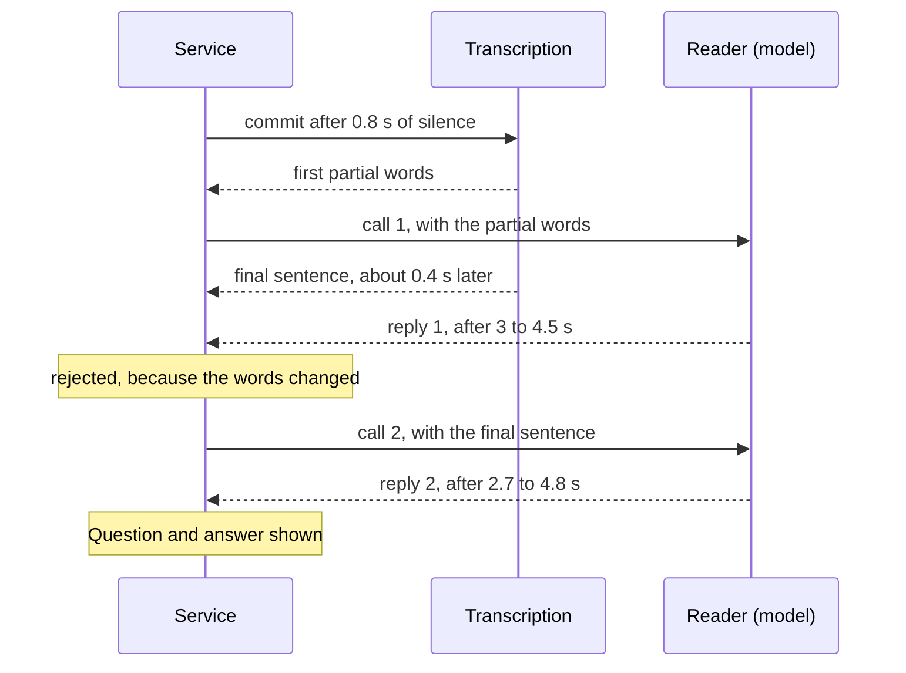

# Response time: the causes

The [measured times](08.1-measured-times.md) show three blocks: waiting for the transcript, a reading that is thrown away, and the reading that is kept. This page names eight causes behind them. Each is either measured, read in the code, or a hypothesis still to be tested, and says which.

*The thrown-away reading, as it happened on five of seven questions: call 1 started about 0.4 s before the final sentence arrived.*

## Eight causes

| # | Cause | Evidence | Kind |
| --- | --- | --- | --- |
| C1 | The reader is called on the first partial words of 8 characters or more. When the final sentence differs, the reply is rejected as `corrected-evidence` and a second call follows. | `poc/session.mjs` lines 109 and 154; 12 of 23 calls | Measured |
| C2 | One call does two jobs: it decides whether a question was asked and writes the answer. Every call carries the whole package, also while Pablo is answering. | `poc/agent.mjs` lines 21 to 25; 16 of 23 calls showed nothing new | Measured |
| C3 | Nothing is shown until the whole reply is complete. The Question waits for the bullets. | `poc/agent.mjs` line 63 awaits the full result | Read in code |
| C4 | The model still writes a `reply` sentence of up to 220 characters and a `phase` before the question. The page shows them only with `#diagnostics`. | `poc/agent.mjs` lines 5, 6 and 42 | Read in code |
| C5 | The prompt changes from its first characters on every call: the session snapshot comes before the package. A provider can reuse only an unchanged beginning, so the package is processed afresh each time. | `poc/agent.mjs` line 24 | Hypothesis: cached-token counts are not recorded |
| C6 | Transcription starts only after the pause, on the whole sentence: 0.8 s of waiting plus about 1.6 s. | `poc/server.mjs` lines 18, 279 and 280 | Measured |
| C7 | The transcriber is not told the language. Two sentences of run C came back as mixed Spanish and English. | `poc/server.mjs` line 189 | Measured; effect on speed unknown |
| C8 | The first call of a session opens a new connection with nothing prepared. | First call of run C took 4.4 s, but the fourth question was as slow | Hypothesis, not supported so far |

## What the causes add up to

- **C1 is certain and free to fix.** It costs 3.3 seconds on most questions and half of the model spend.
- **C2 sets the floor.** A reading with no answer still takes 2.2 to 2.7 seconds, so even a perfect single call cannot put the Question on screen faster than that after the transcript.
- **C3 and C4 delay the Question behind text nobody is waiting for.** The Question is ready inside the reply well before the last bullet is written.
- **C6 is the part a local model removes.** A recogniser that listens while Pablo speaks has the words when he stops.

## A risk with the same root as C1

When call 1 returns before the final sentence arrives, nothing rejects it: the Question is set from the partial words and the final sentence can no longer correct it. This was reproduced with fixtures during the review of 21 November; how often it happens with the real models is not measured. Reading only final text removes both the waste and this risk.

Return to the [analysis](08-response-time.md) or go on to the [proposed design](08.3-proposed-design.md).
