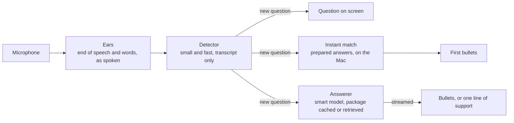

# Response time: the proposed design

The [causes](08.2-causes.md) point to one change of shape. Today a single slow call decides everything, so nothing can appear before it ends. The proposal splits the work into a fast lane, which puts the Question and a first answer on screen, and a smart lane, which adds the considered answer when it is ready. Pablo's idea of two calls in parallel is the last part of it. Everything on this page is a proposal; the times are estimates until measured.

*The fast lane is Ears, Detector, Question and Instant match. The smart lane is the Answerer. Nothing in the fast lane waits for the smart lane.*

## The parts

| Part | Job | Why it is faster | Where it runs |
| --- | --- | --- | --- |
| Ears | Find the end of speech and have the words ready at that moment | No wait for a whole-sentence transcription after the pause (C6) | On the Mac ([08.4](08.4-local-models.md)), or OpenAI as today |
| Detector | Answer one thing: was a new question asked, and what is it | A prompt of a few hundred tokens with no package (C2), and no `reply` text (C4) | A small fast model, cloud or local |
| Instant match | Find a prepared answer for this Question | A lookup, not a model call | On the Mac |
| Answerer | Write the bullets from the package | Runs only for a new Question, with the package as an unchanged beginning (C5), and streams (C3) | The smart cloud model |

## Rules

| ID | Rule | Answers |
| --- | --- | --- |
| RT-1 | A reading starts only on final words, or on words a streaming recogniser has marked stable. | C1 and its risk |
| RT-2 | The Detector never receives the package. The Answerer is called only when the Detector sets a new Question. | C2 |
| RT-3 | The Question is shown the moment the Detector returns. Bullets appear as they are written. | C3 |
| RT-4 | Bullets already shown are not replaced while Pablo may be reading them. The smart lane fills an empty area, or adds one line of support under the first bullets. | Calm screen |
| RT-5 | The package goes first in the Answerer's prompt and does not change during a session. A large package is searched on the Mac and only the relevant parts are sent. | C5, and the 20,000-character limit |
| RT-6 | At Start the service opens its connections and sends the package once, so the first question is not the one that pays for it. | C8 |
| RT-7 | Every stage writes its time, model, effort and token counts to the meeting log. | Measurement |

## Targets, as estimates

| Moment | Today | Target |
| --- | --- | --- |
| Question on screen | 8.6 s mean | 2 s after the end of speech |
| First bullets | 8.6 s mean | 3 to 4 s; with the Question when a prepared answer matches |
| Considered answer or support | none | within 6 s |

## What it costs

- **More moving parts.** Two or three models instead of one, and a helper on the Mac if the Ears or the Detector are local. Each can fail, and each failure must leave the cue timer and the screen working.
- **A screen that changes twice.** RT-4 exists because a second answer arriving under Pablo's eyes works against the glanceable purpose. Whether the smart lane adds or replaces is his decision.
- **A package with prepared answers.** The Instant match needs questions and answers written as pairs, which belongs to the agreement between whoever prepares the package and Alice.

Return to the [analysis](08-response-time.md) or go on to [local models](08.4-local-models.md).
