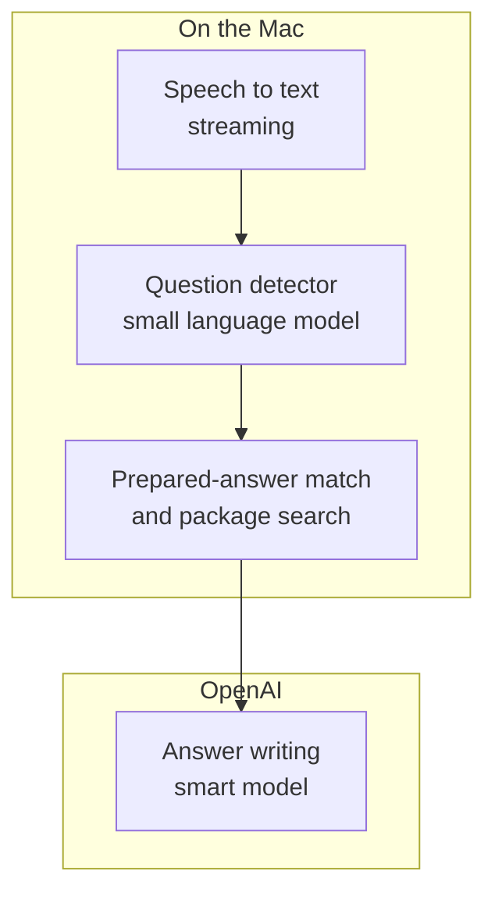

# Response time: what can run on this Mac

The [proposed design](08.3-proposed-design.md) has three jobs that need no cloud model: hearing the words, deciding whether a question was asked, and finding a prepared answer. This page says what can run locally, what it should save and what is not known. No local model has been run for this analysis; every gain here is an expectation to be tested.

*The split proposed for a trial: audio and the first decisions stay on the Mac; only the Question and the relevant package text go out.*

## The machine

Pablo's Mac is an Apple M5 Pro with 24 GB of memory and 15 cores, on macOS 26.5 (read with `sysctl` on 21 November 2026). That is enough for a streaming speech recogniser and a small language model at the same time, alongside a video call. How much they slow the call is not measured.

## Jobs and options

| Job | Local option | Expected gain | Risk or unknown |
| --- | --- | --- | --- |
| Speech to text | A streaming recogniser on the Mac: the system's own speech framework, or a Whisper-family model through a native runtime | Removes most of the 1.6 s of transcription, and gives words while Pablo speaks, so the Detector can start at the pause | Accuracy with his accent and with names. Today OpenAI gets a list of terms from the package; a local model may not take one. |
| End of speech | Keep the level meter, and add a rule that ends the wait early when the words already form a question | 0.3 to 0.5 s of the 0.8 s pause | More sentences cut in two |
| Question detector | A small language model (a few billion parameters) through a local runtime | No network, and it can run on every pause at no cost | Whether a small model tells a question from an answer as well as the cloud model. Unknown speed for this prompt. |
| Prepared-answer match | Compare the Question with the package's question-and-answer pairs, by words or by embeddings | Bullets in milliseconds when a pair matches | Needs a package written with such pairs; a wrong match shows a wrong answer fast |
| Package search | Index the package once at upload and send only the relevant parts | A smaller prompt, and a package far over 20,000 characters becomes usable | Missing the one paragraph that mattered |
| Answer writing | Stay in the cloud | Quality | A local model large enough to match it would be slower on this Mac |

## What changes outside the code

- **Privacy improves, and the statements change.** With local speech to text the audio no longer leaves the Mac; only text does. `poc/README.md` and the root `AGENTS.md` say the opposite today.
- **The dependency rule changes.** Every dependency is an npm package now. A local model needs a native runtime and model files of hundreds of megabytes to a few gigabytes, kept out of Git. That is an architecture decision for stage 05.
- **A language must be chosen.** The transcriber is told none today (C7). A local recogniser usually needs one, or a decision that meetings mix English and Spanish.

## How to try it without betting the sprint

- **One job at a time, speech to text first.** It has the largest sure gain and the clearest test: the same spoken questions through both recognisers, compared word for word and by time.
- **Behind a setting.** The cloud path stays the default until the local one wins on Pablo's own voice.
- **As a trial in stage 06**, not as a change to the working build.

Return to the [analysis](08-response-time.md) or go on to the [plan and experiments](08.5-plan-and-experiments.md).
