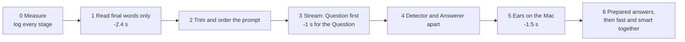

# Response time: order of work and how to measure it

The [proposed design](08.3-proposed-design.md) does not need to be built at once. This page orders the changes from cheap and certain to large and uncertain, gives the expected saving of each, and says how to tell whether a change worked. The savings are estimates from the [measured times](08.1-measured-times.md), except where marked.

*Each step is useful without the next. Steps 0 to 3 change no architecture.*

## The steps

| Step | Change | Expected saving | Confidence | Size |
| --- | --- | --- | --- | --- |
| 0 | Log each stage: end of speech, transcript, each model call with its duration, model, effort, tokens and cached tokens | None; it makes every later number possible | Certain | Small; 08 owns the log fields |
| 1 | Call the reader only on final words (RT-1) | 2.4 s on average, 3.3 s on most questions; half the model spend | High, measured | Small |
| 2 | Drop `reply` and `phase` from the reply, put the package first, warm up at Start (RT-5, RT-6) | Unknown; shows in cached tokens and call time | Hypothesis | Small |
| 3 | Stream the reply and show the Question as soon as it is written (RT-3) | The Question about 1 s earlier | Medium | Medium |
| 4 | Separate Detector and Answerer (RT-2) | The Question about 1 s after the transcript; most calls become small | To measure | Medium |
| 5 | Shorter pause (`ALICE_PAUSE_MS`), then speech to text on the Mac | 0.3 s, then about 1.5 s | Certain, then unknown accuracy | A setting, then a stage 06 trial |
| 6 | Prepared-answer match, then a fast and a smart answer together (RT-4) | First bullets with the Question when matched | Depends on the package | Medium |

## Where that should lead

| After step | Question on screen | First bullets |
| --- | --- | --- |
| Today, measured | 8.6 s (6.4 to 10.3) | 8.6 s |
| 1 | about 6 s | about 6 s |
| 3 | about 5 s | about 6 s |
| 4 | about 3.5 s | 5 to 6 s |
| 5 | about 2 s | about 4 s |
| 6 | about 2 s | 2 to 3 s when a prepared answer matches |

## How to judge a change

- **Same questions each time.** A fixed list of about ten questions, spoken by Pablo or synthetic, asked in each variant three times. Stage 04 owns the method; benchmark recordings are not live inputs.
- **Three numbers per variant.** The median and the worst time to the Question, and the same to the first bullets, read from the log of step 0.
- **Quality beside speed.** Pablo marks each answer usable or not, so a faster model that answers worse is seen.
- **Cost.** Tokens per question, read from the log.
- **One change at a time**, so a gain can be traced to its cause.

## Decisions this needs

| Who | Decision |
| --- | --- |
| Pablo | Does a later, smarter answer add a line or replace the bullets (RT-4)? One language or mixed? Is a helper program on the Mac acceptable? |
| 05 Architecture | The two-lane design, the dependency rule for local models, and the data statements |
| 08 Detailed Design | The log fields of step 0 and the rules RT-1 to RT-7 |
| 04 Evaluation | The fixed question list and the pass rule for each step |
| 06 POC | The speech-to-text trial on this Mac |

Return to the [analysis](08-response-time.md) or to the [solution guide](README.md).
