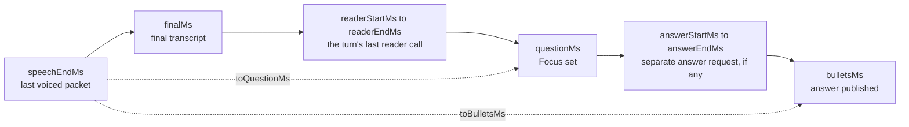

# The two measurement lines in the meeting log

To measure how fast Alice answers, each listening session writes two more kinds of line to its [meeting log](../meeting-log.md): `model_call`, one for every call to a model, and `question_timing`, one for every speech turn the reader looked at. They hold numbers and fixed code words only, never words that were said, shown or sent. Adding them changed nothing Alice does: the same calls, prompts, timing and page (08 rules RT5-4, RT5-5 and RT5-8), and the log stays at version 1.

*One turn, left to right, on the clock of every line's `ms`. A stage that did not happen is `null`.*

## `model_call`: one line per call

| Field | Meaning |
| --- | --- |
| `kind`, `callId` | `reader` or `answer`; 1, 2, … in the order the calls start, both kinds together. Each attempt of the answer request is its own call. |
| `startMs`, `durationMs` | When the call started, and how long until its reply, its failure or its drop. |
| `outcome` | `question`: something new was shown (a Question, a candidate or the bullets). `no-question`: accepted, nothing new. `rejected`, `failed` or `dropped`. A call shows nothing unless it is `question`. |
| `reason` | `null` for the first two outcomes. Rejected: the session's reason, such as `stale-revision`, `schema` or `greetings-after-question`; a reading whose words changed is always `corrected-evidence`, whichever check refused it first. Failed: `timeout`, `aborted`, `auth`, `rate-limit`, `model-access`, `invalid-result:<check>` or `error`. Dropped: `stopped`, `superseded` or `stale-version`. |
| `model`, `effort` | The model name and the reasoning effort sent with the call. |
| `inputTokens`, `cachedTokens`, `outputTokens` | From the usage of the reply; all `null` when there is none, as for a failed or dropped call. `cachedTokens` is the part of `inputTokens` the provider reused; `null` there alone means usage came without a cache count. |

## `question_timing`: one line per turn

A turn is the speech that ended at the last voiced packet before a reader call. Calls made in the same pause belong to one turn, so a reading refused and the reading kept give two `model_call` lines and one `question_timing`. Since the reader starts on final words only (RT5-1), a turn usually has one call. The line is written when the turn ends, and `outcome` says how:

- `bullets`: the answer was published.
- `no-question`, `rejected` or `failed` with no Focus: the turn's last reading gave no Question.
- `failed` with a Focus: both attempts of the answer request failed.
- `superseded`: a newer question or turn took over. `stopped`: Stop came first.

With no Focus, `focusVersion`, `questionMs` and both differences are `null`. When the reader's own reply carried the bullets, which is the usual case, `answerStartMs` and `answerEndMs` are `null` and `bulletsMs` equals `questionMs`.

## What a reader of the numbers should know

- **`speechEndMs` is when the last voiced packet reached the service**, good to one packet (0.1 s). The `pause` line gives the same instant as `startMs`, but counted in audio from the first packet, so the two numbers differ by a constant: the time from the log's start to the first packet.
- **`bulletsMs` is when the service published the answer.** In the [measured sessions](08.1-measured-times.md) the page showed it 2 to 7 ms later.
- **A noise during the pause counts as speech**, as it does for `pause` lines, and moves `speechEndMs`.
- **A reader call made before any speech** has a `model_call` and no turn. It happens only with the pause rule off, as in the tests; in real use the first reading waits for the first pause.
- **Token counts were checked against a stubbed reply, not a live one.** The first real log will show whether the provider reports cached tokens for these calls.
- **A hosted service with `ALICE_LOG=off`** has no log, so neither line is written.
- **`speech_lost`** is a third line of the same sprint: `audioMs` of speech whose words never arrived, written before `session_stopped` (RT5-6). A Stop that got its last words writes none.

Code: [session](../session.md) (`openTurn`, `endTurn`), [answer area](../answer-area.md) (`endCall`) and [agent](../agent.md) (`usageOf`, `callEvent`). Tests: ST5-5, ST5-6, ST5-7 and ST5-11 in the [test guide](../poc.test.md). Back to the [guide index](README.md).
