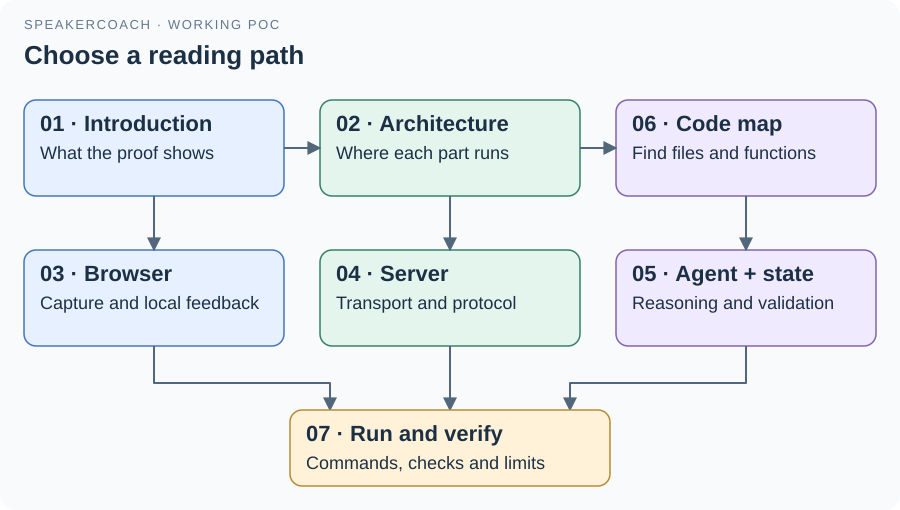

# SpeakerCoach POC: solution guide

This guide explains the implemented proof of concept: the browser keeps its immediate audio feedback while a local service transcribes speech and returns a real OpenAI agent response.
Start with the introduction, then use the architecture and code map to locate the part you want to understand.

| Read | What it explains |
| --- | --- |
| [01 · Introduction](01-introduction.md) | What the POC proves, what the user sees and its present limits |
| [02 · Architecture](02-architecture.md) | Browser, local service and cloud boundaries; component ownership |
| [03 · Browser and audio](03-browser-and-audio.md) | Independent audio paths, local timing and capture cleanup |
| [04 · Server and protocol](04-server-and-protocol.md) | Routes, WebSocket packets, transcription and failure handling |
| [05 · Agent and state](05-agent-and-state.md) | Model calls, observation snapshots and validated updates |
| [06 · Code navigation](06-code-navigation.md) | Where to start reading and where to make a particular change |
| [07 · Running and verification](07-running-and-verification.md) | Startup, configuration, test commands and evidence |

For a quick source tour, read [the code map](06-code-navigation.md). For a specific interface, follow its link to the existing Markdown companion beside the code.
These documents describe the inspected source. The earlier [POC results](../RESULTS.md) and [technical evidence](../evidence.json) retain the original execution record.
The new [documentation review record](review.json) identifies source hashes, document hashes and visual checks for this guide.
