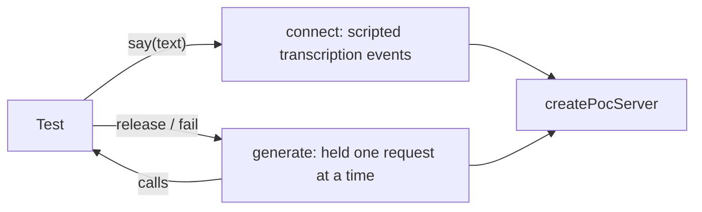

# Fixtures for answer tests and page checks

[Source: fixtures.mjs](fixtures.mjs) · used by [poc.test.mjs](poc.test.md)

Fixtures replace the two OpenAI connections the service already accepts as options, so tests and scripted page checks drive every answer state with no key and no network. All text here is invented.

*A request waits in the fixture until the test releases or fails it, oldest first.*

| Member | Contract |
| --- | --- |
| `createFixtures()` | Returns `{connect, generate, say, release, fail, calls, waiting, upstream}`. Also the default export. |
| `connect()` | A fake upstream socket: answers `session.update` with `session.updated` and records what it is sent. |
| `say(text)` | Emits committed, one delta and completed transcription events for a new item. |
| `generate(request, {signal, meter})` | Records a clone of the request in `calls` with its signal, then waits. An abort rejects it and removes it from the queue. |
| `release(result, usage?)` / `fail(error)` | Settle the oldest waiting request; throw if none waits. With `usage`, `release` first reports it through `meter` as the call's token counts; without it the call has none. |

The module reads no file and never refers to the benchmark folder or a real preparation package; each test builds its synthetic package in a temporary folder.
