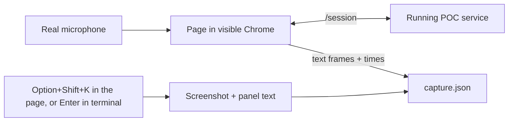

# Live session capture

[live-capture.mjs](live-capture.mjs) records evidence while Pablo runs the [UC-04 live check](../docs/asdg/09-build-and-test-cycle/01-uc-04-live-check-plan.md). It opens the page in a visible Chrome with the real microphone, logs the page's `/session` messages with times, saves the log every 3 seconds, and takes a checkpoint when Pablo presses Option+Shift+K in the page.



Start the service first (`bash poc/start.sh`), then run from the project root:

```bash
PLAYWRIGHT_MODULE=/path/to/playwright/index.mjs CHROME_PATH="/Applications/Google Chrome.app/Contents/MacOS/Google Chrome" node poc/live-capture.mjs [output-folder]
```

| Input | Meaning |
| --- | --- |
| `output-folder` | Default `/tmp/speakercoach-live-<time>`, outside the repository |
| `POC_URL` | Service origin, default `http://127.0.0.1:3000`; microphone permission is granted for it |
| Option+Shift+K in the page (Alt+Shift+K elsewhere) | Saves `checkpoint-NN.png` and the Focus, Live (with tag and note), feedback, hint, signal and server text, then shows "capture checkpoint N saved" briefly |
| A label then Enter in the terminal | The same checkpoint, labelled |
| Closing Chrome, Ctrl+C, or `q` then Enter | Finishes and writes the final `capture.json`; it is also saved every 3 seconds |
| `--dry-run` | Headless Chrome with a fake microphone; presses Start Listening and the page hotkey, then closes the window itself; a plumbing check |

`capture.json` holds every text frame with `at` (ms) and `direction`, the number of audio packets sent (audio itself is not stored), checkpoints and page errors. A sent `question.confirm` is the click time; a sent `rendered` is the render time; the server's `question_control` and `transcript_final` audit events give commit and transcript times.
The file contains transcript and question text from the session, so it stays local by default. Run with only scripted speech, and copy into project documentation only the wording needed as evidence.
The hotkey listener and the confirmation note are added by this script only, not by the page. `--dry-run`, autosave and Ctrl+C saving were checked on 4 November 2026 against a fake service (real server code, scripted transcription and reasoning). It does not prove anything about recognition or real timing.
