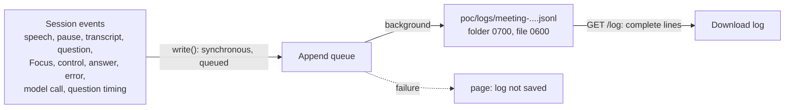

# Meeting log writer

[Source: meeting-log.mjs](meeting-log.mjs) · used by [server.mjs](server.md); events come from [session](session.md) and [answer area](answer-area.md)

Each listening session appends what was heard and shown to one private file, so Pablo can review the meeting afterwards. The file lives in `poc/logs/` (Git-ignored), nothing reads it back except the Download log button, and the writer can never hold up the audio.

*`write()` returns at once. A slow or failing disk delays or drops log lines, never audio packets.*

| Interface | Contract |
| --- | --- |
| `new MeetingLog({dir, sessionId, wallNow, mono, maxBytes, onFail})` | One file named `meeting-<UTC start 20261119T104207Z>-<first 8 of the session id>.jsonl`. `write(type, data)` adds `t` (ISO UTC, ms) and `ms` (since the session started, monotonic) and queues the line; `elapsed()` returns that `ms`. Past `maxBytes` (5 MB) the next line is replaced by one `log_full` and nothing more is written. `flush()` waits for queued lines; `close()` queues the close. |
| `createLogStore({dir, wallNow, mono, maxBytes})` | Folder from the option, `ALICE_LOG_DIR` or `poc/logs/`. `start(sessionId, onFail)` begins a log; `read()` returns `{filename, text}` of the current or newest log, complete lines only, or `null`. It never lists or deletes. |
| `DEFAULT_LOG_DIR`, `LOG_MAX_BYTES`, `LOG_VERSION` | `poc/logs/`, 5 MB and 1. |

Failure: if the folder or file cannot be opened or a write fails, `onFail` runs once (the page is told `log` / `not saved`) and later lines are dropped; the session goes on. The download name is `alice-meeting-<UTC start>.jsonl`. Rules: ML-1 to ML-15 and MS-1 to MS-9.
Never written: package text or names, the key, prompts, hints, replies, audio. Bullets shown may quote the package and are logged (decided).

## Fixes of 22 November 2026

- **`log_full`.** The last line now holds only `t`, `ms`, `type` and `maxBytes`. Before, it carried the whole event that did not fit, so a long transcript could push the file over its cap (MS-4).
- **`read()`.** If this process's newest log file is missing or unreadable, the most recent other log in the folder is returned, so Download log still works (SD-1).

## Measurement lines (SPRINT-005)

Two event types were added, `model_call` and `question_timing`; [the guide](docs/09-measurement-events.md) explains their fields. They hold times, counts, the model name and fixed code words, and no text. `LOG_VERSION` stays 1: a new event type changes no existing meaning, and a reader skips the types and fields it does not know (RT5-8, ML-1).
