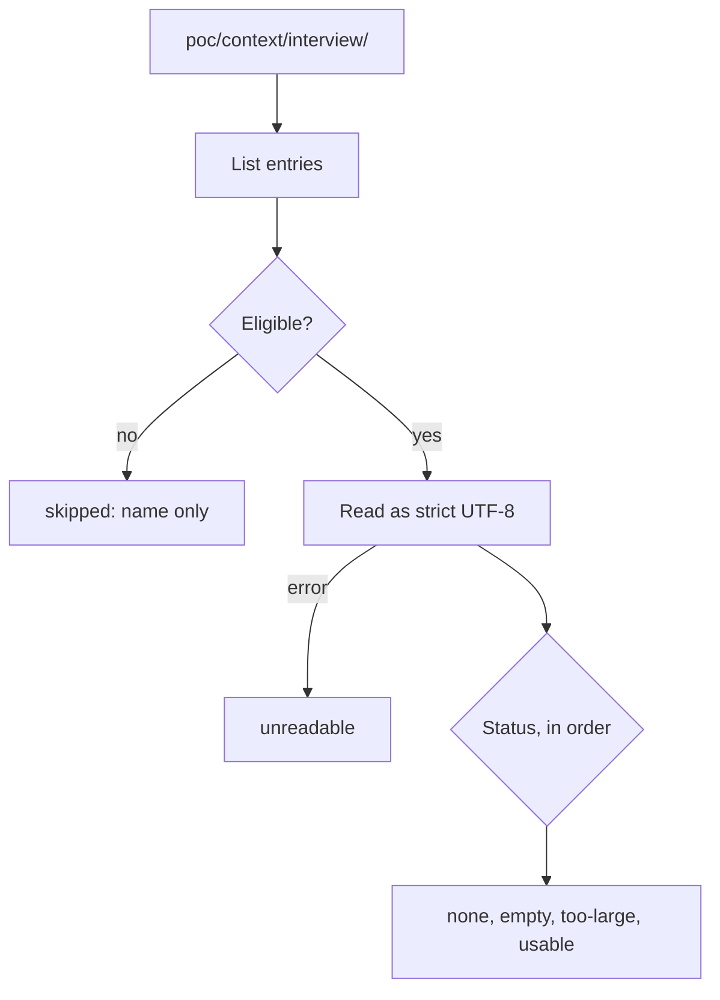

# Preparation package loader

[Source: package-loader.mjs](package-loader.mjs) · used by [server.mjs](server.mjs) and the reviewer script [review/package-check.mjs](review/package-check.md)

Pablo's preparation documents are plain files in a Git-ignored folder, and everything the loader accepts is sent to OpenAI with each confirmed question. The loader is therefore strict and never cuts a package.



*Anything but `usable` means no document is used and the answer is General. Only names, counts and digests ever leave the loader as metadata.*

| Interface | Contract |
| --- | --- |
| `loadPackage(dir?)` | Returns `{status, found, skipped, chars, files:[{name,chars,sha256}], documents}`. `documents` is `[{name,text}]` in code-unit name order only when `status` is `usable`, else `[]`. Never throws. |
| `readPackage(dir?)` | Lower level: eligible names, skipped names, files with text and a failure count. The reviewer script reuses it so both apply one eligibility rule. |
| `reasonOf(status)` | The General reason code: `null` for `none`, the status itself for `too-large`, `empty`, `unreadable`, `undefined` for `usable`. |
| `PACKAGE_MAX` | 20,000 characters, string length of the decoded texts, no separators. |
| `DEFAULT_PACKAGE_DIR` | `poc/context/interview/`. Replaced by the `ALICE_PACKAGE_DIR` setting or the `packageDir` option of `createPocServer`. |

Eligible: a regular file directly in the folder, extension `.txt` or `.md` in any case, name not starting with a dot and not `README.md` in any case. Symbolic links and subfolders are skipped and never followed. A missing folder is `none`.
Status order: no eligible file → `none`; any read or decoding failure → `unreadable`; only blank text → `empty`; over 20,000 → `too-large`; otherwise `usable`. The `sha256` is of the file bytes, matching the `package_loaded` audit.
Collaborators: [server](server.md) reads it once per session before `ready` and on each `/health`; [answer area](answer-area.md) holds the result in memory.

```javascript
const pkg = await loadPackage('/tmp/synthetic-package');
// { status: 'usable', documents: [{ name: 'a.txt', text: '…' }], … }
```
