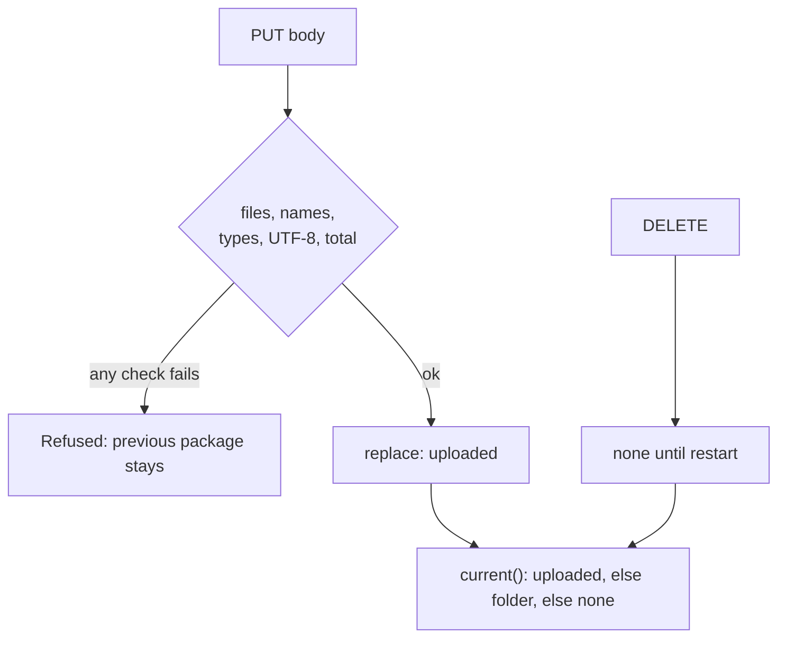

# Package store and upload rules

[Source: package-store.mjs](package-store.mjs) · used by [server.mjs](server.md) for `GET`, `PUT` and `DELETE /package`

The package in use is one of three things: one uploaded from the page, the folder package, or nothing. The store holds it in memory only, checks every upload and hands a session its snapshot at Start. SPRINT-004 rules SU-3 to SU-10.

*A refusal changes nothing. Remove also clears the folder package until the service restarts.*

| Interface | Contract |
| --- | --- |
| `buildUpload(body)` | Returns `{ok:true, package, skipped:[{name,reason}]}` or `{ok:false, reason, name?, chars?}`. Reasons: `too-many-files` (over 20), `refused` (bad shape, duplicate or unsafe name), `unreadable` (U+FFFD or NUL), `empty`, `too-large` (over 20,000 characters). |
| `createPackageStore(dir)` | `current()` gives `{source, pkg}` in the shape of the [loader](package-loader.md); `status()`, `replace(pkg)` and `remove()` give counts only: `{source, status, files, chars, terms}`. |
| `BODY_MAX` / `FILES_MAX` | 200 KB and 20. |

Unsafe names (a `/`, `\`, `..`, drive letter, control character or over 255 characters) refuse the whole upload and are never trimmed. Hidden files, `README.md` and other types are skipped and listed back to the sender. Documents are sorted by name, as the folder loader does. File text never leaves this module except as the session's snapshot.
