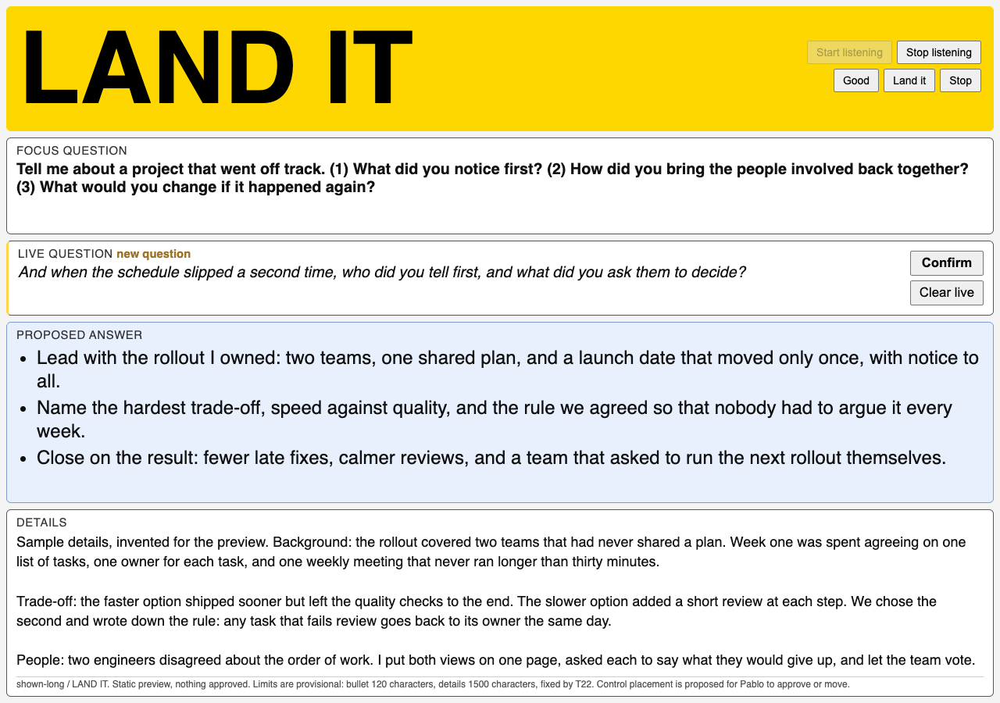

# Static layout preview (SPRINT-003)

[Source: index.html](index.html) · styles [preview.css](preview.css) · script [preview.js](preview.js) · companion [preview.md](preview.md)

## Who uses it and what it is

Pablo, the only user, opens this page to approve or change the layout of the new Alice page before it is built (task T21). It is **not** the product page and approves nothing by itself; approval is by SHA-256 of these files (rule PV-6). It uses invented sample text only, makes no network request beyond its own three files, and uses no microphone, key, package or OpenAI.

*Screenshot of this preview, `#state=shown-long&cue=land-it`, captured at 1280 × 900. It shows the proposed layout, not the product. A 390 × 844 capture of the same state with GOOD is [preview-shown-long-narrow.png](images/preview-shown-long-narrow.png).*

## Responsibilities

| Part | Responsibility | Collaborator |
| --- | --- | --- |
| `index.html` | Holds the link list and the page skeleton: cue band, Focus, Live, answer card, details | `preview.js`, `preview.css` |
| Link list | Shown with no fragment; one link per state, per cue and the one extra state | `preview.js` |
| Page | Shown for `#state=<state>&cue=<cue>`; fixed row heights keep the four glance elements still | `preview.js` |

Served at `/preview` from the service's fixed file list ([server.md](../server.md)).
