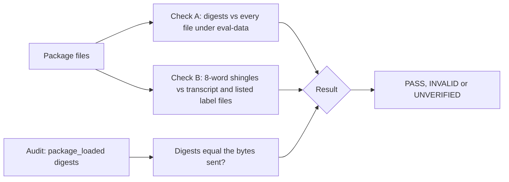

# Reviewer package check

[Source: package-check.mjs](package-check.mjs) · procedure: [04 package and statement checks](../../docs/asdg/04-benchmarks-and-eval-strategy/03.8-sprint-003-package-and-statement-checks.md)

The reviewer runs this by hand before a billable run to show that nothing from the benchmark is in the text sent to OpenAI. It reads private benchmark text and reports counts and line numbers only, never text. Nothing else in `poc/` imports or runs it: not the service, `alice-run.sh` or `node --test poc/poc.test.mjs` (rule PK-11, checked by ST-57).

*INVALID and UNVERIFIED both stop the run; Pablo judges any shingle match himself by reading the reported lines.*

| Interface | Contract |
| --- | --- |
| Command | `node poc/review/package-check.mjs [--audit FILE] [--benchmark FILE]... [--package-dir DIR] [--eval-dir DIR]` |
| Exit codes | 0 PASS; 1 INVALID (any equal digest or shingle match); 2 UNVERIFIED (no audit given, a digest differs from the audit, a benchmark source is missing or unreadable, or `transcript.json` and `transcript.txt` are not found); 64 bad arguments. |
| `checkPackage(options)` | Returns the report object; `formatReport(report)` renders the text. |
| Normalising | NFC, lower case, punctuation and symbols removed, spaces collapsed, eight-word shingles. JSON sources contribute their string values. |

Benchmark sources are every `transcript.json` and `transcript.txt` under `eval-data/` plus any file given with `--benchmark` (evaluator labels and reference answers are listed by the reviewer). The audit file is the service's standard output, one JSON event per line; its last `package_loaded` event supplies the digests. A `PASS` is evidence for the reviewer, not an approval.
Collaborators: [package loader](../package-loader.md) supplies the eligibility rule and digests.
