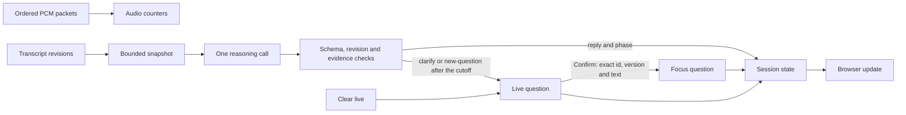

# Audio session and accepted interview state

[session.mjs](session.mjs) owns one connection's counters, observations, pending reasoning and accepted display state.

| Interface | Contract |
| --- | --- |
| `new InterviewSession({reason, emit, audit?, delayMs?})` | Injects async reasoning and event sinks; default minimum start interval is 2500 ms |
| `audio(Buffer)` | Requires 4808 bytes: little-endian uint32 sequence, uint32 starting sample, then 2400 PCM16 samples; rejects gaps |
| `committed(id, previousId)` | Records committed segment order, retaining at most 32 IDs |
| `observe(id, text, final)` | Appends deltas or replaces them with final text; final duplicates are ignored |
| `snapshot()` | Copies state, audio cutoff and up to six observations, each capped at 4000 characters |
| `accept(proposal, snapshot)` | Rejects bad schemas, stale revisions, unsupported citations and corrected evidence, recording why in `lastRejection`; updates reply, phase and Live, never Focus |
| `resetLive()` | Clears Live, retires its id and moves the Live cutoff, even when Live is empty; returns `{status: 'reset', changed}` |
| `confirm(request)` | The only writer of Focus: commits Live only if id, versions and exact text match; returns `confirmed`, `stale`, `invalid` or `unavailable` |
| `control(message)` | Validates a `question.reset` or `question.confirm` control, emits one `question.result`, then any state broadcast |
| `schedule()` / `run()` | Coalesces input into one pending run while audio proceeds; request timeout is 30 seconds |
| `stop()` | Aborts reasoning, clears scheduling and discards observations; late results cannot emit |

Events carry session identity and server wall-clock time. Accepted answers have increasing revisions. Browser acknowledgements are separate evidence.
State holds `focus` (confirmed text or null), `focusVersion` (0 until the first confirmation), `exchangeId` and `live`, which is null or `{id, version, text, kind}` with `kind` `new` or `restatement`. The [UC-04 design](../docs/asdg/08-low-level-design/03.2-uc-04-state-and-rules.md) defines these rules.
A result in the ANSWER phase without a Focus question keeps the current phase but still updates the reply and Live.
Only `clarify` and `new-question` proposals with text change Live, and only when they cite an observation newer than the Live cutoff: the observations present at the last Confirm or Clear live. A new Live gets a fresh id and version 1; text changes add 1; `new-question` sets kind `new`. With Live empty, a `clarify` opens a `restatement`, and text equal to Focus is ignored.
Confirm sets Focus to the Live text, adds 1 to `focusVersion`, sets phase QUESTION, clears Live and moves the cutoff. A confirmed restatement keeps the exchange; anything else starts one. A retired Live id is `stale`, an id never issued is `invalid`, and Live text equal to Focus is `unavailable`.
Each live session caches up to 256 well-formed controls by `requestId`. An identical retry re-sends the original result; a changed payload is `invalid`; a new request beyond the cap is `limit`. Malformed or wrong-session controls are `invalid` and are not cached. Every reply is audited as `question_control`, and each final transcript as `transcript_final`, without text. A rejected agent result's `agent_finished` event adds `rejection`: `reason` is `stopped`, `wrong-session`, `stale-revision`, `schema` (with the failing field names), `length`, `unknown-evidence`, `missing-evidence`, `corrected-evidence` or `greetings-after-question`.
These checks constrain updates; they do not establish semantic accuracy or speaker identity.
Network failure keeps the last result in the browser. A new connection starts a new session rather than silently reconstructing missing audio.
