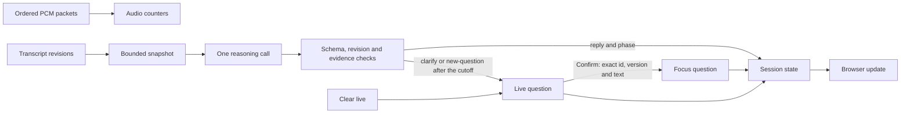

# Audio session and accepted interview state

[session.mjs](session.mjs) owns one connection's counters, observations, pending reasoning and accepted display state.

| Interface | Contract |
| --- | --- |
| `new InterviewSession({reason, emit, audit?, delayMs?, generate?, now?, answerTimeoutMs?, print?})` | Injects async reasoning and event sinks; default minimum start interval is 2500 ms. `generate`, `now`, `answerTimeoutMs` and `print` feed the [answer area](answer-area.md); without `generate` no answer is prepared |
| `audio(Buffer)` | Requires 4808 bytes: little-endian uint32 sequence, uint32 starting sample, then 2400 PCM16 samples; rejects gaps |
| `committed(id, previousId)` | Records committed segment order, retaining at most 32 IDs |
| `observe(id, text, final)` | Appends deltas or replaces them with final text; final duplicates are ignored |
| `snapshot()` | Copies state, audio cutoff and up to six observations, each capped at 4000 characters |
| `accept(proposal, snapshot)` | Rejects bad schemas, stale revisions, unsupported citations and corrected evidence, recording why in `lastRejection`; updates reply, phase and Live, never Focus |
| `resetLive()` | Clears Live, retires its id and moves the Live cutoff, even when Live is empty; returns `{status: 'reset', changed}` |
| `confirm(request)` | The only writer of Focus: commits Live only if id, versions and exact text match; returns `confirmed`, `stale`, `invalid` or `unavailable`. A `confirmed` result also starts the proposed answer for the new Focus version |
| `control(message)` | Validates a `question.reset` or `question.confirm` control, emits one `question.result`, then any state broadcast |
| `schedule()` / `run()` | Coalesces input into one pending run while audio proceeds; request timeout is 30 seconds |
| `stop()` | Publishes the answer area as last known, aborts reasoning and any answer request, clears scheduling and discards observations; late results cannot emit |
| `voiced()` / `rendered(message)` | Service hooks: the first voiced packet after Confirm (`tS`) and the page's render report (`t3`), passed to the answer area. `voiced()` also notes when the last voiced packet arrived |
| Measurement lines (SPRINT-005) | Log bookkeeping that no decision reads. `run()` writes one `model_call` per reader call and passes the reader a fourth argument that receives its token counts; `openTurn`, `turnRead`, `focused`, `answerStage` and `endTurn` keep each speech turn and write its one `question_timing`. Times come from the optional `elapsed()`, which the service points at the log's clock. `stop()` writes a reading in flight as `dropped` and ends the open turns. See [the measurement lines](docs/09-measurement-events.md) |

Events carry session identity and server wall-clock time. Accepted answers have increasing revisions. Browser acknowledgements are separate evidence.
State holds `focus` (confirmed text or null), `focusVersion` (0 until the first confirmation), `exchangeId` and `live`, which is null or `{id, version, text, kind}` with `kind` `new` or `restatement`. The [UC-04 design](../docs/asdg/08-low-level-design/03.2-uc-04-state-and-rules.md) defines these rules.
A result in the ANSWER phase without a Focus question keeps the current phase but still updates the reply and Live.
Only `clarify` and `new-question` proposals with text change Live, and only when they cite an observation newer than the Live cutoff: the observations present at the last Confirm or Clear live. A new Live gets a fresh id and version 1; text changes add 1; `new-question` sets kind `new`. With Live empty, a `clarify` opens a `restatement`, and text equal to Focus is ignored.
Confirm sets Focus to the Live text, adds 1 to `focusVersion`, sets phase QUESTION, clears Live and moves the cutoff. A confirmed restatement keeps the exchange; anything else starts one. A retired Live id is `stale`, an id never issued is `invalid`, and Live text equal to Focus is `unavailable`.
Each live session caches up to 256 well-formed controls by `requestId`. An identical retry re-sends the original result; a changed payload is `invalid`; a new request beyond the cap is `limit`. Malformed or wrong-session controls are `invalid` and are not cached. Every reply is audited as `question_control`, and each final transcript as `transcript_final`, without text. A rejected agent result's `agent_finished` event adds `rejection`: `reason` is `stopped`, `wrong-session`, `stale-revision`, `schema` (with the failing field names), `length`, `unknown-evidence`, `missing-evidence`, `corrected-evidence` or `greetings-after-question`.
These checks constrain updates; they do not establish semantic accuracy or speaker identity. Network failure keeps the last result in the browser. A new connection starts a new session rather than silently reconstructing missing audio.

The proposed answer lives in `answers` (an [AnswerArea](answer-area.md)), apart from `state`: it is not in snapshots or cached results and never changes `revision`. `answer` messages also carry `proposed` and `proposedSeq`; a finished result is published as one `proposed` message. The interview agent never sees the answer or the package.

## Automatic flow (18 November 2026)

With `autoFocus` on (the default), a clear question read after a pause becomes the Focus question at once; there is no Confirm. `adopt` sets Focus, raises the Focus version, keeps Live showing the reading (its id is retired, so Confirm stays disabled while Live matches Focus) and moves the Live cutoff so the same speech cannot be used twice. A question that repeats the Focus wording, or cites only speech already used, changes nothing. A reading with no clear question keeps the last answer and the agent status says `no question heard; keeping the last answer`. A later clear question replaces the earlier reading, and a `clarify` keeps the exchange.
The answer comes from the same call: `startAnswer` checks its bullets (and any `details` field the reader added, which makes the answer invalid) with `validateResult` and shows them through `AnswerArea.present`; if they are not valid it falls back to the separate answer request (`begin`). `setContext` gives the package terms and documents to the reader. With `autoFocus` off only the manual Live then Confirm path exists; the tests use it for the older cases.

## Meeting log events and transcript items (SPRINT-004)

The constructor takes `record(type, data)`, which the service points at the [meeting log](meeting-log.md); the default does nothing. The session records `transcript` (final items only, with the audio span `audioStartMs`/`audioEndMs` from the commit the service sent), `live_question`, `live_cleared` (`clear` or `confirm`), `focus_changed` (source `pause`, `confirm-button` or `confirm-space`) and `control` (how it was used: the optional `via` of a question control is `button`, `space` or `escape`, default `button`; replays are not logged). `commitSent()` and `bufferCleared()` are called by the service so each item knows its span. The `transcript` message now carries `items`, a snapshot that replaces the last: the last 30 s, at most 8 items and 1,500 characters, each `{id, text, final, at}` with `at` in ms from the session start (SA-17); the older `text` and `final` stay for the current page. Nothing here reaches the audit.

## Fixes of 21 and 22 November 2026

- **Empty items (21 November).** `items()` skips an item whose text is empty or white space (a noise-only commit comes back empty) and no longer stops at it, so the snapshot keeps the earlier items of the last 30 seconds. The empty final item is still logged as a `transcript` event (ML-4) and still given to the reader as an observation.
- **Control order.** While a Confirm or Clear runs, the events it causes are held; the `control` line is written first, then `live_cleared` and `focus_changed` (ML-12).
- **Refused controls.** A malformed Confirm or Clear, a retry with a changed payload and a request over the 256 limit are each logged as `control` with result `invalid` (ML-7). An identical retry is still not logged again.
- **Reader failures.** A reading that fails writes an `error` event with code `reader` and the public message (ML-10); the abort at Stop does not.
- **Unknown fields.** `startAnswer` refuses the answer part of a reply that carries any field outside reply, phase, question, intent, evidenceIds, covered and bullets, and falls back to the answer request (AD-3). Before, only `details` was refused.
