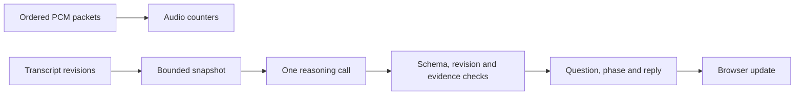

# Audio session and accepted interview state

[session.mjs](session.mjs) owns one connection's counters, observations, pending reasoning and accepted display state.

| Interface | Contract |
| --- | --- |
| `new InterviewSession({reason, emit, audit?, delayMs?})` | Injects async reasoning and event sinks; default minimum start interval is 2500 ms |
| `audio(Buffer)` | Requires 4808 bytes: little-endian uint32 sequence, uint32 starting sample, then 2400 PCM16 samples; rejects gaps |
| `committed(id, previousId)` | Records committed segment order, retaining at most 32 IDs |
| `observe(id, text, final)` | Appends deltas or replaces them with final text; final duplicates are ignored |
| `snapshot()` | Copies state, audio cutoff and up to six observations, each capped at 4000 characters |
| `accept(proposal, snapshot)` | Rejects bad schemas, stale revisions, unsupported citations and corrected evidence; retains question during ANSWER |
| `schedule()` / `run()` | Coalesces input into one pending run while audio proceeds; request timeout is 30 seconds |
| `stop()` | Aborts reasoning, clears scheduling and discards observations; late results cannot emit |

Events carry session identity and server wall-clock time. Accepted answers have increasing revisions. Browser acknowledgements are separate evidence.
A question is established only by a QUESTION proposal citing final text. These checks constrain updates; they do not establish semantic accuracy or speaker identity.
Network failure keeps the last result in the browser. A new connection starts a new session rather than silently reconstructing missing audio.
